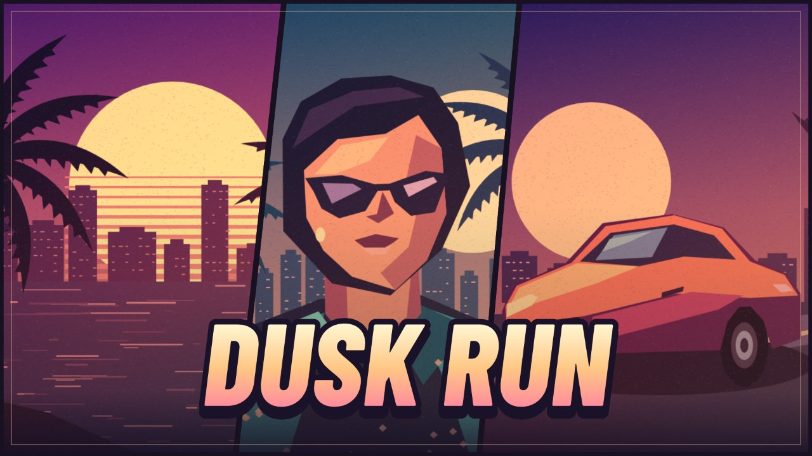

# 余晖封面工作室 / Afterglow Cover Studio

[在线使用 / Open in browser](https://xialin99.github.io/makefun-afterglow-cover-studio/)

[中文](#中文) · [English](#english)

## 中文

### 第一次使用

1. [打开封面编辑器](https://xialin99.github.io/makefun-afterglow-cover-studio/)。无需安装或登录。
2. 点击一个画格，再点 **更换图片**。选择照片后拖动图片调整构图，用缩放滑块放大。
3. 输入封面文字，选择横版、方形或竖版，然后点 **下载 PNG**。文件在浏览器的下载文件夹。

离线封面编辑器，支持拖放图片、裁剪、调色、文字和多种尺寸的 PNG 导出。

### 本地运行

用桌面 Chrome 打开 `app/index.html`，选择或拖入图片，调整构图后导出。

页面默认显示简体中文，可以在界面选择 English。

## English

### First use

1. [Open the cover editor](https://xialin99.github.io/makefun-afterglow-cover-studio/). No installation or account is required.
2. Choose a panel, click **Replace photo**, then drag or zoom to frame it.
3. Enter a caption, choose an export size, and click **Download PNG**. Look in your browser’s downloads.

An offline cover editor with image drop, crop, color grading, captions and multiple PNG output sizes.

### Run locally

Open `app/index.html` in desktop Chrome, select or drop a photo, adjust the framing, and export.

The interface opens in Simplified Chinese. Use the language menu to switch to English.

[中文技术说明](README.details.zh.md) · [English technical notes](README.details.md)

[make.fun 赛事 / Original bounty](https://make.fun/bounty/gta6-cover-art-01)

## 许可证 / License

MIT. See [LICENSE](LICENSE).

赛事模板组件的授权见 [LICENSE-makefun.txt](LICENSE-makefun.txt)。

Kit components are covered by [LICENSE-makefun.txt](LICENSE-makefun.txt).

字体采用 SIL OFL 1.1，详见 [字体许可](app/fonts/OFL.txt)与 [DM Sans 许可](app/fonts/DM-OFL.txt)。

Fonts are provided under SIL OFL 1.1. See the [Barlow](app/fonts/OFL.txt) and [DM Sans](app/fonts/DM-OFL.txt) notices.

